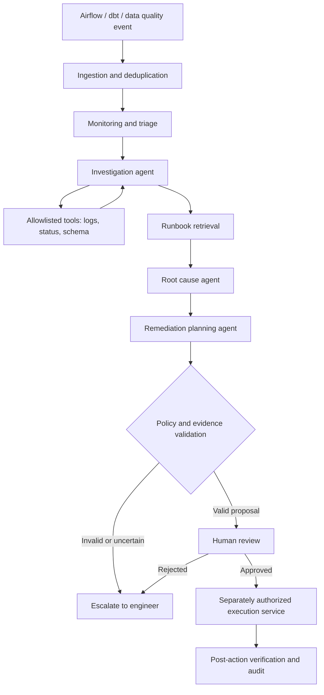

# Enterprise architecture and roadmap

## Why this is agentic instead of a chatbot

The Investigation Agent can inspect an incident and dynamically choose the next
**read-only** tool based on returned evidence, instead of replaying an answer
from a predefined Q&A prompt. Its choices and actions are bounded. The Root
Cause Agent then creates a structured claim referencing observed evidence.
Policy gates control everything related to real-world side effects.

## Flow

## Orchestrators supplied in this repository

- `workflow.py`: dependency-light sequence for development and debugging.
- `langgraph_workflow.py`: actual LangGraph `StateGraph` with distinct nodes,
  conditional routing after evidence/policy checks, and an escalation branch.
  The knowledge node calls an optional LangChain in-memory vector retriever with
  toy hash embeddings. These embeddings are NOT production-grade.
  Turn on via `AGENTOPS_ENGINE=langgraph` once the optional extra is installed.
- `examples/human_review_interrupt.py`: demonstrates `interrupt`, `Command`,
  and `InMemorySaver`. The FastAPI review endpoint records only an SQLite
  simulation; it is **not** the same workflow as the separate interrupt demo.

## Six agent functions

1. **Monitoring** (deterministic): normalize alerts and prioritize events.
2. **Investigation** (LLM with read-only tools): decide what diagnostic evidence
   to collect, subject to a strict call budget.
3. **Knowledge** (retrieval): choose relevant, versioned runbooks, validating
   their source and access scope. This starter uses fixture-based retrieval.
4. **Root cause** (LLM): propose a diagnosis, evidence IDs, uncertainty.
5. **Remediation planning** (deterministic policy + suggested plan): propose
   only approved action types; never execute writes.
6. **Reporting** (deterministic): summarize evidence, approvals, and audit.

## Production stack

| Layer | Recommended technology | Rationale |
|---|---|---|
| Orchestration | LangGraph v1 | Explicit nodes, durable state, interrupts |
| API | FastAPI + Pydantic | Typed schemas and validation |
| Event source | Airflow callbacks, dbt artifacts, quality checks | Real operational incident signals |
| Message bus | Kafka or managed queue | Decouple ingestion from investigations |
| Operational DB | PostgreSQL | Incidents, audits, review statuses |
| Checkpointer | PostgreSQL LangGraph checkpointer | Persist active agent runs |
| Retrieval | PostgreSQL pgvector initially | Search historical incidents and runbooks |
| Cache | Redis (optional) | Rate limits and short-lived dedup/cache |
| Inference | Approved configurable enterprise LLM | Tool choices, RCA, structured diagnosis |
| Telemetry | OpenTelemetry + Prometheus/Grafana | Traces, cost, latency and SLOs |
| Deployment | Docker + Kubernetes | Repeatable workloads and scaling |
| CI | GitHub Actions + pytest + security scans | Reproducible regression and release checks |

## What is deliberately deterministic?

- Alert schema validation and deduplication
- Access control and allowed diagnostic tools
- Timeouts, budgets, retry limits and idempotency
- Policy checks, review gates and authorization
- All production action execution

**LLM calls are justified** for adaptive investigative tool choice and
synthesizing competing root-cause hypotheses from structured evidence. Avoid an
LLM call simply to look up a known incident ID or threshold.

## Production security boundaries

- Treat all logs, web pages, runbooks and tool outputs as untrusted input.
- Enforce authorization in tool implementations, not prompt instructions.
- Explicit typed allowlists; never give a model raw SQL, arbitrary shell, or
  arbitrary HTTP requests to private network destinations.
- Separate read credentials and deployment credentials.
- Require an authenticated reviewer and policy checks before any write.
- Use step budgets, token budgets, rate limits, tenant scoping, audit trails,
  output validation and constrained context retention.
- Guard against prompt injection in a fake log line that says 'ignore all rules'.

## Rollout

**Phase 1 — 2 weeks:** synthetic pipelines, mock incidents, API, evidence tracing.

**Phase 2 — 2 weeks:** real read-only Airflow/dbt connectors, runbook ingestion,
replay tests, structured LLM responses, incident memory.

**Phase 3 — 2 weeks:** LangGraph durable checkpoints, production auth, approvals,
queue workers and observability. No autonomous production changes.

**Phase 4 — 2+ weeks:** controlled remediation service, staging dry-run, risk-tier
policies, rollback procedures, fault injection and security review.
